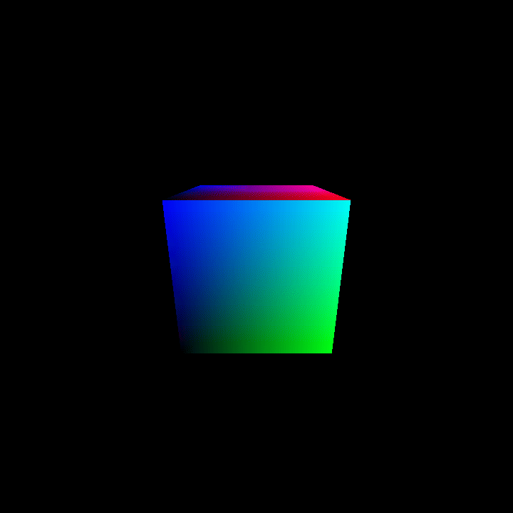

# Python Software Renderer

A small software rasterizer written in pure Python with Pillow.

## Features
- 3D rotation
- Perspective projection
- Backface culling
- Z-buffer depth testing
- Perspective-correct texture mapping
- Animated GIF export

## How to run
pip install -r requirements.txt
python create_textures.py
python main.py

## What I learned
- Triangle rasterization
- Edge functions / barycentric coordinates
- Depth buffering
- Texture mapping